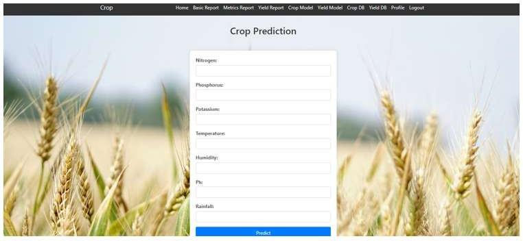
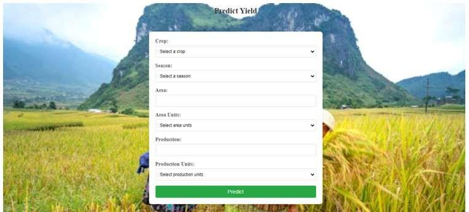
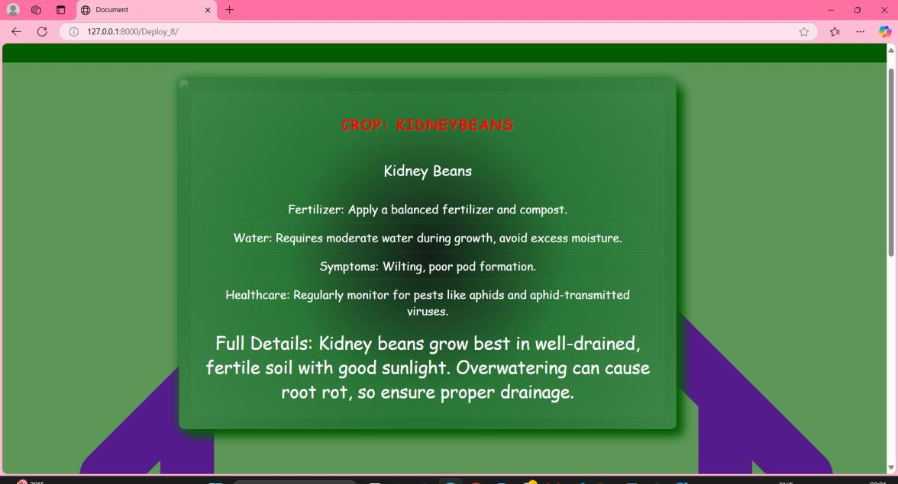
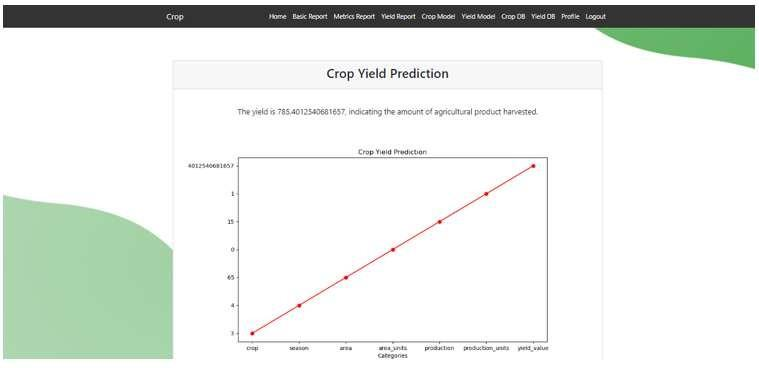
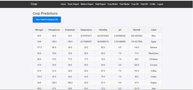
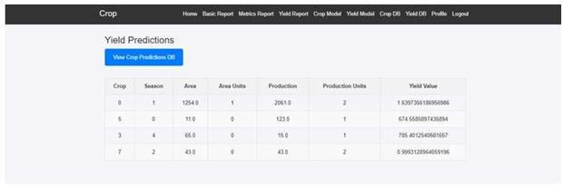

# AI-Powered Crop Yield Prediction (Django + Machine Learning)

A Django web application that uses machine learning to **recommend a crop** from soil and weather conditions and to **predict crop yield**. Users can register, log in, run predictions, and review their saved prediction history.

> Academic project (B.Tech Information Technology, 2025). The Django source code was recovered from the Appendix of the project report. The crop model, training notebook and HTML templates were rebuilt later, because they weren't in the report. See [What's included](#whats-included-and-whats-not) for details.

## Features

- **Crop prediction:** enter nitrogen, phosphorus, potassium, temperature, humidity, pH and rainfall; the model returns one of 22 crops (rice, maize, coffee, cotton, apple, and more).
- **Yield prediction:** enter crop, season, area and production details; the model returns the expected yield, shown with a plot.
- **Prediction history:** every crop and yield prediction is saved in SQLite and listed on a results page.
- **User accounts:** registration, login with "remember me", profile with avatar and bio, password change, and Google/GitHub sign-in (OAuth).
- Report pages for the basic analysis, model metrics and yield analysis.

## Tech stack

| Layer | Tools |
|---|---|
| Language | Python, HTML, CSS, JavaScript |
| Backend | Django |
| ML | Scikit-learn (MLP Classifier, Bagging Classifier, Random Forest), Joblib |
| Data and plots | NumPy, Pandas, Matplotlib, Seaborn |
| Auth | Django auth, social-auth-app-django (Google, GitHub) |
| Database | SQLite |
| Frontend | Bootstrap 5 |
| Dataset | Crop Recommendation dataset (Kaggle) |

## Crop recommendation model

Trained in [`notebooks/crop_recommendation_model.ipynb`](notebooks/crop_recommendation_model.ipynb) on 2,200 samples (22 crops, 100 each), 80/20 train-test split:

| Model | CV accuracy | Test accuracy |
|---|---|---|
| **Random Forest** (used in the app) | 99.43% | 99.55% |
| MLP Classifier | 98.58% | 99.09% |
| Bagging Classifier | 99.20% | 99.09% |

This dataset is clean and its classes are well separated, so near-perfect accuracy is expected. Real field data would be noisier and harder.

## Yield model (as reported)

The yield model was not recoverable from the report, so these figures are **from the project report**, not re-measured here:

| Metric | Value |
|---|---|
| MAE | 5.2% |
| RMSE | 6.8% |
| R² score | 0.87 |

## Screenshots

These are from the original project (taken from the report). The templates in this repo are a rebuild, so the styling differs.

| Crop prediction | Yield prediction |
|---|---|
|  |  |

| Crop result | Yield result |
|---|---|
|  |  |

| Saved crop predictions | Saved yield predictions |
|---|---|
|  |  |

## Project structure

```
├── manage.py
├── requirements.txt
├── .env.example                 # names of the environment variables the app reads
├── data/
│   └── crop_recommendation.csv  # dataset used to train the crop model
├── notebooks/
│   └── crop_recommendation_model.ipynb   # EDA, model comparison, saves users/crop1.pkl
├── user_management/             # Django project (settings, urls, wsgi, asgi)
├── users/                       # Django app
│   ├── models.py                # Profile, UserPredictModel, yield_db
│   ├── forms.py
│   ├── views.py                 # auth views + crop and yield prediction views
│   ├── urls.py
│   ├── signals.py
│   ├── crop1.pkl                # trained crop model
│   ├── migrations/
│   └── templates/               # HTML pages
├── media/default.jpg            # default profile picture
└── screenshots/
```

## What's included, and what's not

| Part | Status |
|---|---|
| Django source code (settings, models, forms, views, urls) | Recovered from the project report's appendix |
| Crop model (`crop1.pkl`), training notebook, dataset | Rebuilt for this repo and measured here |
| HTML templates, migrations, default avatar | Rebuilt for this repo |
| **Yield model (`YIELD.pkl`) and its dataset** | **Not included** |

The yield page is built and its code works, but it needs a trained `YIELD.pkl` in the `users/` folder. Until then, it shows a "model not available yet" message instead of crashing. The category fields on that page (crop, season, units) take the numeric codes the model was trained with.

## Running it

Requires **Python 3.11+**.

```bash
git clone https://github.com/Haritha-malealattane/crop-yield-prediction-ml.git
cd crop-yield-prediction-ml

python -m venv venv
venv\Scripts\activate            # macOS/Linux: source venv/bin/activate
pip install -r requirements.txt

# the app reads its secrets from environment variables (see .env.example), e.g. on Windows cmd:
set SECRET_KEY=your-secret-key

python manage.py migrate
python manage.py runserver
```

Open http://127.0.0.1:8000/. Google/GitHub sign-in only works after you set the `GITHUB_*` / `GOOGLE_*` variables.

To retrain the crop model, run the notebook (`pip install notebook`, then `jupyter notebook`). It overwrites `users/crop1.pkl`. Keep the scikit-learn version pinned in `requirements.txt` so the saved model loads.

## Notes on the code

- Hardcoded local file paths for the models were replaced with relative paths, and models load on first use.
- Imports were consolidated and the PDF's broken indentation was fixed.
- `home()` and `index()`, the start of `RegisterView`, and the arguments of the `login/` URL were missing in the report, so they are reconstructed (marked with `NOTE` comments in the code).
- Passwords, keys and secrets are read from environment variables, never stored in the code.
- `DEBUG = True` is set for development. Change it before any real deployment.

## Future work

- Add the yield model and dataset
- Integrate real-time sensor/IoT and satellite data
- Region-specific models for different soil types and crop varieties
- Deep learning models (e.g. LSTM) for time-series yield forecasting
